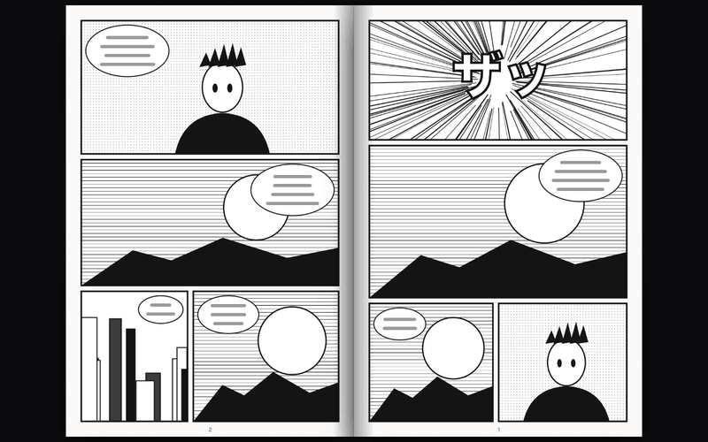
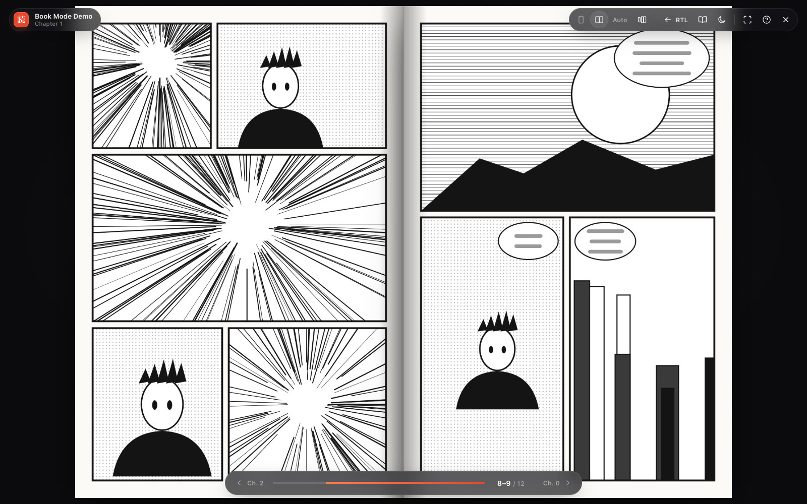
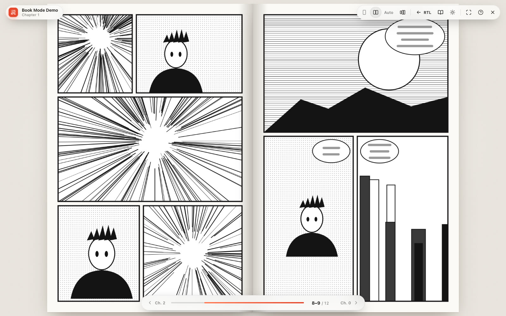

<div align="center">


# Manga Reader – Book Mode

**Read manga like a real book, right in your browser.**
Full-page fit, double-page spreads, right-to-left reading and a page that actually turns.

[](https://github.com/0xsysone/manga-reader-book-mode/stargazers)
[](https://github.com/0xsysone/manga-reader-book-mode/network/members)
[](LICENSE)




<sub>Demo pages are original placeholder art made for this README.</sub>

</div>

---

## Why

Most manga sites show chapters as one long vertical strip. You scroll, lose your place, and never see a two-page spread the way the artist drew it.

**Book Mode** puts the pages you're already viewing into a proper reader:

- one page or a full spread, always fitted to the screen with no scrolling;
- read in the Japanese order, from right to left;
- turn the page with a single key.

## Features

| | |
| --- | --- |
| 📖 **Full-page fit** | Every page fills the screen height. No scrolling, no cropping. |
| 🪟 **Double-page spreads** | Two pages side by side, like an open tankōbon. In *Auto* mode spreads turn on when the window is wide enough. The cover stays alone, and landscape art (original double spreads) stays in one piece. |
| ⬅️ **Right-to-left by default** | `←` moves forward and the first page of a spread sits on the right. Western order is one key away. |
| 🎞️ **A page that actually turns** | 3D page flip around the spine, with cast shadows and paper sheen. Prefer something calmer? Pick *Slide* or *None*. |
| 🌙 **Dark & paper themes** | Pure black for night reading, warm paper for daytime. |
| ⌨️ **Keyboard-first** | Arrows, space, Home/End and chapter jumps. Mouse wheel, click zones and touch swipes work too. |
| ⏭️ **Chapter to chapter** | Press once more at the last page to open the next chapter. The previous chapter opens on its last page. |
| 🔎 **Zoom that follows the cursor** | Read small text without leaving the spread. |
| 🧭 **Progress bar** | Follows your reading direction and previews pages on hover. |
| 🌍 **7 languages** | The interface follows your browser language: English, Français, Español, Português (Brasil), Deutsch, Bahasa Indonesia and 日本語. |
| 🔒 **Private by design** | No account, no tracking, no analytics. Settings are stored by Chrome; the only network call is to the public MangaDex API when you read on mangadex.org. |

<p align="center">
  
  
</p>

## Install

### From source (available now)

1. Download or clone this repository.
2. Open `chrome://extensions` and switch on **Developer mode**.
3. Click **Load unpacked** and select the project folder.

Works in Chrome, Edge, Brave, Opera and other Chromium browsers.

### Chrome Web Store

Coming soon.

## Usage

1. Open a manga chapter on a site.
2. Click the **Manga Reader** icon, then **Enable** in the site card.
   Chrome asks for access to **that domain only**, and nothing else.
3. The reader opens right away, and on every later visit to that site.

`Esc` brings you back to the site. The floating **Read in book mode** button reopens the reader. **Disable** in the same card removes the script and gives the permission back to Chrome.

### Keyboard shortcuts

| Action | Keys |
| --- | --- |
| Next / previous page | `←` / `→` in right-to-left (swapped in left-to-right), `Space` / `⇧ Space`, wheel, swipe |
| First / last page | `Home` / `End` |
| Next / previous chapter | `N` / `P`, or press again at the end/start |
| Single → double → auto | `D` |
| Shift pairs (cover alone) | `O` |
| Reading direction | `S` |
| Animation | `A` |
| Dark / paper | `M` |
| Zoom | `Z` or double-click |
| Fullscreen | `F` |
| Help | `?` |
| Close | `Esc` |

## How it finds the pages

The reader never downloads, stores or re-hosts anything. It uses the images the site you opened already shows, and tries these in order:

1. **Dedicated adapters** for a few sites with unusual readers, plus the **MangaDex public API**.
2. **Known reader engines**: the WordPress *MangaReader* theme (`ts_reader`), *Madara*, the *my Manga Reader* CMS and other common chapter layouts. Lazy-loaded images (`data-src`, `srcset`…) are supported.
3. **Generic detection**: the largest group of large images in one container. Logos, banners, ads and webtoon strips are filtered out. When this method is used, the reader offers a button instead of opening on its own.

**Not supported, by design:**
- **DRM platforms.** Izneo draws its pages into a `<canvas>` from protected data, so there is no image to reuse. Google Play Books is DRM-protected too and isn't supported. The extension never tries to get around such protections.
- **Webtoons** (long vertical strips) aren't made for book mode.

## Under the hood

- **Manifest V3** with zero dependencies, zero build step and zero remote code.
- **Shadow DOM** overlay, so the site's CSS and the reader never interfere.
- **Per-site permissions** through `optional_host_permissions` and `chrome.scripting.registerContentScripts`. A background service worker keeps sites, permissions and scripts in sync.
- **The page turn** uses pure CSS 3D (a two-faced leaf rotating around the spine) driven by the Web Animations API, with an animation queue so fast key presses never stutter.
- **Pure logic** (spread pairing, layout, key mapping, detection) lives in `src/core.js` and is unit-tested with `node --test`.

```
manifest.json
src/core.js      pure logic: extraction, detection, spread pairing, keys, layout
src/i18n.js      interface translations through chrome.i18n
src/styles.js    reader styles (isolated in the Shadow DOM)
src/reader.js    the book: rendering, 3D page turn, UI, preloading
src/content.js   chapter detection, settings, launcher
src/sites.js     enabled sites: permissions and dynamic content scripts
background.js    service worker keeping sites, permissions and scripts consistent
popup/           settings and site activation
_locales/        interface text in 7 languages
test/            unit tests
```

## Development

```bash
node --test test/
```

No `npm install` needed. Edit a file, then click the reload button on `chrome://extensions`.

## Roadmap

- [x] Interface in 7 languages (en, fr, es, pt-BR, de, id, ja)
- [ ] Chrome Web Store release
- [ ] Edge Add-ons and Firefox builds
- [ ] Resume where you left off across series
- [ ] Per-series settings

Ideas and pull requests are welcome. Open an issue first for anything big.

**New language?** Copy `_locales/en/messages.json` to `_locales/<code>/messages.json`, translate the `message` values (keep the `$PLACEHOLDERS$`), then run `node --test test/`: it checks that every key and placeholder is there.

## Contributing

1. Fork the repo and create a branch.
2. Keep `src/core.js` free of DOM code, and add a test for new logic.
3. Run `node --test test/`, then open a pull request.

Found a site where pages aren't detected? Open an issue with the reader engine if you know it, but **no links to infringing content**.

## Disclaimer

This extension is a display tool. It hosts no content and links to none. It only rearranges images the site you're visiting has already shown you. Please support the creators and read through official sources whenever you can.

## License

[MIT](LICENSE)

French documentation: [docs/README.fr.md](docs/README.fr.md).

---

## Adoption

<div align="center">

[](https://github.com/0xsysone/manga-reader-book-mode/stargazers)
[](https://github.com/0xsysone/manga-reader-book-mode/network/members)
[](https://github.com/0xsysone/manga-reader-book-mode/watchers)
[](https://github.com/0xsysone/manga-reader-book-mode/graphs/contributors)
[](https://github.com/0xsysone/manga-reader-book-mode/issues)
[](https://github.com/0xsysone/manga-reader-book-mode/commits)

<!-- After the Chrome Web Store release, replace EXTENSION_ID and uncomment:
[](https://chromewebstore.google.com/detail/EXTENSION_ID)
[](https://chromewebstore.google.com/detail/EXTENSION_ID)
-->

### Star history

<a href="https://star-history.com/#0xsysone/manga-reader-book-mode&Date">
  <picture>
    <source media="(prefers-color-scheme: dark)" srcset="https://api.star-history.com/svg?repos=0xsysone/manga-reader-book-mode&type=Date&theme=dark">
    
  </picture>
</a>

### Contributors

<a href="https://github.com/0xsysone/manga-reader-book-mode/graphs/contributors">
  
</a>

If Book Mode makes your reading nicer, a ⭐ helps other readers find it.

</div>
